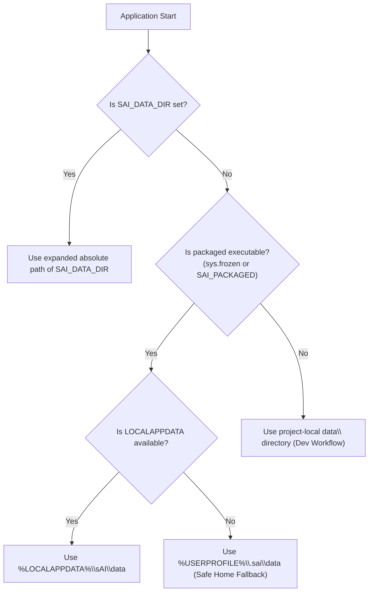

# sAI User Data Directory Architecture & Migration Report

**Task:** Task 020 — Safe User Data Directory Migration
**Date:** November 4, 2026
**Auditor:** Antigravity Assistant
**Status:** **IMPLEMENTED AND VERIFIED (57/57 TESTS PASSING)**

---

## 1. Executive Summary

To ensure sAI can be safely distributed and installed on Windows 10/11 without encountering filesystem permission errors (such as non-admin execution inside `C:\Program Files\`), a robust user-data directory architecture and safe first-run migration system have been implemented in `backend/storage.py` and integrated into `backend/config.py`.

The system guarantees:
- **Packaged Executables:** Write exclusively to `%LOCALAPPDATA%\sAI\data` (with an explicit fallback to `%USERPROFILE%\.sai\data` if `LOCALAPPDATA` is missing), preventing `PermissionError: [WinError 5] Access is denied`.
- **Source Development:** Continues to use the project-local `data/` directory, maintaining 100% developer workflow parity.
- **Explicit Override:** Respects `SAI_DATA_DIR` across all environments.
- **Non-Destructive Migration:** Safely copies legacy settings, profiles, SQLite databases, and uploads to the new directory without deleting originals or overwriting existing target files.
- **SQLite Safety:** Migration runs prior to database connection instantiation, ensuring zero write contention or transaction corruption.

---

## 2. Storage Path Precedence Policy

All persistent storage paths across the application (`Settings`, `ProfileMemory`, `Memory`, `FileManager`, `Logger`, and `Vision`) derive from `DATA_DIR` in `backend/config.py`.

`backend/storage.py:get_data_dir()` resolves `DATA_DIR` using the following strict precedence:

1. **`SAI_DATA_DIR` (Highest Priority):**
   - If configured in the environment, its expanded absolute path is used immediately.
2. **Packaged Executable Mode (`is_packaged_executable()`):**
   - Checked via `getattr(sys, "frozen", False)` or environment flag `SAI_PACKAGED`.
   - Defaults to `%LOCALAPPDATA%\sAI\data`.
   - If `LOCALAPPDATA` is missing or empty, explicitly falls back to `Path.home() / ".sai" / "data"`. It never silently defaults to a protected installation folder.
3. **Source Development Mode (Default):**
   - Retains `BASE_DIR / "data"`. Existing local configurations, databases, and logs remain active without disruption.

---

## 3. Safe Legacy Data Migration Rules

When a packaged application boots for the first time (or when `SAI_LEGACY_DATA_DIR` is set), `backend/storage.py:maybe_run_migration()` executes `migrate_legacy_data(source_dir, target_dir)`:

1. **Copy, Never Move:** Source files are copied using `shutil.copy2()`, preserving file content, permissions, and timestamps. No source file is ever deleted or renamed.
2. **Never Overwrite:** If a file already exists in the destination (e.g. user has newer settings), it is skipped and counted as a conflict.
3. **Repeat-Safe (Idempotent):** Running migration multiple times does not corrupt, duplicate, or alter existing data.
4. **Secrets & Residuals Excluded:**
   - Excludes `.env` files (protecting credentials and API keys).
   - Excludes virtual environments (`venv`, `.venv`), Git repositories (`.git`), bytecode (`__pycache__`, `*.pyc`), and OS caches (`desktop.ini`, `thumbs.db`).
5. **Full Hierarchy Preserved:** Subdirectories such as `memory/`, `uploads/`, `logs/`, and `cache/` are recreated with their exact nested structures.
6. **SQLite WAL Integrity:** Migration executes before `Memory()` or `Database()` connects. SQLite databases (`memory.db`) and any active WAL/SHM sidecars are transferred cleanly while closed.

---

## 4. Test Coverage Matrix

A comprehensive dedicated test suite was implemented in [`tests/test_storage_migration.py`](file:///D:/EXTRAS/Projects/sAI/tests/test_storage_migration.py), running entirely in isolated temporary directories:

| Test Case | Description | Result |
| :--- | :--- | :--- |
| `test_explicit_sai_data_dir_override` | Verifies `SAI_DATA_DIR` takes top precedence. | **PASS** |
| `test_packaged_application_path_selection` | Verifies packaged mode selects `%LOCALAPPDATA%\sAI\data`. | **PASS** |
| `test_packaged_application_path_fallback_when_localappdata_missing` | Verifies safe fallback to `~/.sai/data` if `LOCALAPPDATA` is absent. | **PASS** |
| `test_source_development_path_preservation` | Verifies non-packaged source execution preserves local `data/`. | **PASS** |
| `test_first_run_migration_from_legacy_data` | Verifies legacy files copy cleanly into target on first run. | **PASS** |
| `test_existing_destination_files_are_never_overwritten` | Confirms target files are protected from overwrite conflicts. | **PASS** |
| `test_repeated_migration_is_safe` | Confirms subsequent runs produce 0 duplicate copies or corruption. | **PASS** |
| `test_migration_preserves_nested_directories_and_file_contents` | Confirms nested binary and text files retain byte-exact content. | **PASS** |
| `test_migration_failure_is_reported_clearly` | Confirms unwritable destinations raise descriptive `RuntimeError`. | **PASS** |
| `test_settings_and_profile_load_from_migrated_location` | Confirms `Settings` and `ProfileMemory` load properly from target. | **PASS** |
| `test_sqlite_conversation_history_remains_readable_after_migration` | Confirms SQLite conversation rows read back accurately post-migration. | **PASS** |
| `test_no_original_user_files_are_deleted` | Confirms source files retain identical modification times and data. | **PASS** |
| `test_paths_containing_spaces_and_non_ascii_characters_work` | Confirms directories with spaces and Unicode (`Ûñicøde`) migrate cleanly. | **PASS** |
| `test_env_files_are_excluded_from_migration` | Confirms `.env` files are rejected and never copied to target. | **PASS** |

Total test suite execution: **57 / 57 tests passing** (43 regression/readiness + 14 storage/migration tests).

---

## 5. Limitations & Packaging Guidelines for Task 021

1. **Installer Scope:** Inno Setup should be configured with `PrivilegesRequired=lowest` and target `{localappdata}\Programs\sAI`. This avoids requiring UAC elevation for ordinary users.
2. **Uninstaller Policy:** The Inno Setup uninstaller must uninstall only `{localappdata}\Programs\sAI` application binaries, leaving `%LOCALAPPDATA%\sAI\data` untouched so user chat history is preserved across reinstalls.
3. **Hardware / VRAM Constraints:** Model selection in Settings still depends on the user choosing an Ollama model fitting their RAM (e.g. 4B parameter model for 8–16 GB RAM).

---

## 6. Rollback Procedure

If a packaged user ever needs to revert or restore data:
1. All original files in the legacy installation folder remain 100% intact because migration is non-destructive (copy-only).
2. The user can manually inspect or delete `%LOCALAPPDATA%\sAI\data` to reset packaged application state.
3. Setting `SAI_DATA_DIR="<path>"` immediately redirects the application to any specified backup directory without code changes.
